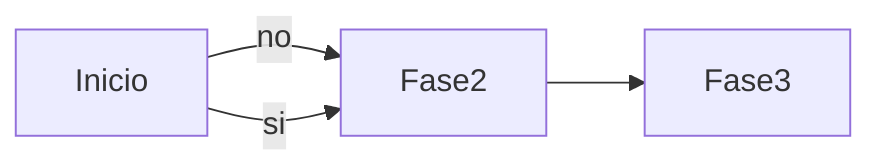

# Titulo
## Subtitulo
Esta es mi 1ra frase de Markdown.\
Y esta es mi 2da frase.

Quiero crear un parrafo nuevo.


### Formatos de texto

**Negritas**
*Cursiva*
***Ambas***
~~Tachado~~

#### Codigo 
Codigo en linea (comandos) \
`Git status` : Comando de GIt que devuleve INFO. de mi area de trabajo.

Codigo en bloque\
```sql
select * from tabla;
```


* Punto 1
+ Punto 2
- Punto 3
    - subelemento 1
        - subelemneto 2. 
        1. pepe
        2. maria
        3. jesus
            1. pepe

### Citas/Avisos
> ***OJO***: Cuidado al descargar el archivo prueba.exe

#### Tablas

| Columna 1 | Columna 2 | Columna 3 |
|-----------|-----------|-----------|
| element 1 | elemnto mas amplio | asdad |


##### Representaciones Graficas



### Imagenes y URLs


Esto permite entrar al [Ministerio de sanidad que no funciona](https://www.sanidad.gob.es/areas/DCVIHT/vihSida/PrEP/home.htm)

### Desplegable

<details>
<summary>Pulsa aquí para desplegar</summary>
Hola Marta

</details>
